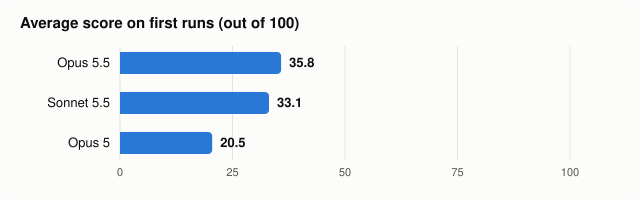

# mosaic-benchmarks

Headline results from **Mosaic**, Motif Platforms' benchmark of AI agents on real business deliverables: the decks,
memos and models a consultant or analyst hands to a client. Each agent works alone, produces an actual Office file,
and the file is graded, not the chat.

This repo publishes summaries only. Task briefs, inputs, answer keys, per-run scores and judge notes stay private so
the tasks remain usable as a held-out test.

## PowerPoint, October 2026

| Model | Runs | Completed | Avg score, first run | Avg score, all runs | Runs with working think-cell | Avg cost per run | Avg minutes per run |
|---|---:|---:|---:|---:|---:|---:|---:|
| Opus 5.5 | 22 | 21 | 35.8 | 40.7 | 6 | $4.35 | 14.4 |
| Sonnet 5.5 | 22 | 22 | 33.1 | 32.7 | 0 | $1.17 | 9.4 |
| Opus 5 | 11 | 9 | 20.5 | 20.5 | 0 | $10.20 | 24.7 |

**What stands out**

- Scores out of 100 are low across the board. A deck has to meet the brief item by item, with editable working
  charts, to score well, and none of the models did that reliably.
- Opus 5.5 was the only model that built real think-cell charts (6 of 22 runs). The others used native PowerPoint
  charts even when the brief asked for think-cell.
- Sonnet 5.5 came within three points of Opus 5.5 on first runs at about a quarter of the cost.

**Setup.** 11 tasks (7 build a deck from public filings, reports and datasets; 4 edit an existing deck). Each model
ran unattended in Claude Code on a Mac with PowerPoint and think-cell installed, with no web access. Every deck was
checked by script, rendered by PowerPoint itself, and then scored blind by a judge model against a 100-point rubric.
Runs took place from October 17 to October 24, 2026.

**Rubric (100 points)**

| Dimension | Points |
|---|---:|
| Task requirements | 30 |
| Code level | 15 |
| think-cell | 15 |
| Domain | 10 |
| Automated | 10 |
| Stylistic | 10 |
| Calculations | 10 |

Notes: a failed run (no deck delivered) scores 0 and counts in the averages. Opus 5 ran each task once and the other
two models ran each task twice, so the first-run column compares like with like. Totals include the rubric's gates
and an adjustment for missed task requirements. Machine-readable figures:
[`powerpoint-2026-10/summary.json`](powerpoint-2026-10/summary.json).

## How the grading works

The open core of the grading pattern (file inspectors, checks that explain themselves, a JSON rubric) is in
[motifplatforms/aspera-grader-kit](https://github.com/motifplatforms/aspera-grader-kit). The reasoning behind it is in
the series [Teaching machines to do real work](https://www.motifplatforms.com/insights).

## Contact

Want your agent, or your own tasks, run through Mosaic? [dsaran@motifplatforms.com](mailto:dsaran@motifplatforms.com)

Summaries and chart: CC BY 4.0, © 2026 Motif Platforms.
